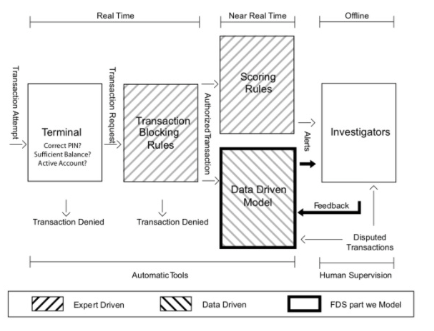
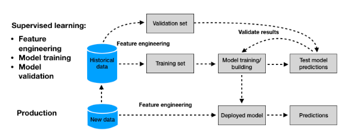
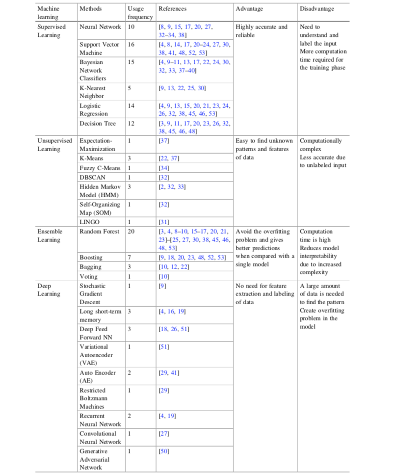

# Chapter 2: Background

## Credit card fraud scenarios

Transaction fraud scenarios are distinguished into two categories:
- **Card-present (CP) frauds**: Refer to scenarios where a physical card is needed, such as transactions at a store (also referred to as a point-of-sale - POS) or transactions at a cashpoint (for instance at an automated teller machine - ATM). CP frauds are usually categorized:

    - **Lost or stolen card**: The card belongs to a legitimate customer, and gets in the hands of a fraudster after a loss or a theft. This is the most common type of fraud. In this scenario, the fraudster usually tries to spend as much as possible and as quickly as possible
    - **Counterfeited card**: A fake card is produced by a fraudster, by imprinting the information of a card. Such information is usually obtained by skimming the card of the legitimate customer, without them noticing. Since the legitimate owners are not aware of the existence of a copy of their card, the source of the fraud might be more difficult to identify, since the fraudster can wait a long time before making use of the fake card. The increased use of chip-and-PIN (aka EMV) technology has reduced this type of fraud
    - **Card not received**: The card was intercepted by a fraudster in the mailbox of a legitimate customer. This may happen if a customer orders a new card, which gets intercepted, or if a fraudster manages to order a new card without the knowledge of the legitimate customer (for example by accessing fraudulently their bank account), and have it delivered to a different address. In the former case, the customers may quickly warn the bank that their card was not received, and have it blocked. The latter case can be harder to detect since the customer is not aware that a new card was ordered

- **Card-not-present (CNP) frauds**: Refer to scenarios where a physical card does not need to be used, which encompasses payments performed on the Internet, by phone, or by mail

    - Most CNP frauds are a direct consequence of illegally obtained payment credentials (e.g., card numbers), either from data breaches or sometimes directly from the cardholders (e.g. via phishing, scam text messages). Also worth noting, such credentials are usually not used directly, but rather put on sale on underground web marketplaces (the dark web), and later used by criminal groups. Criminals who steal data are usually a different group than criminals who perpetrate frauds
    - The data that is generally involved in card-not-present fraud involves the card number, card expiration date, card security code, and personal billing information (such as the cardholder’s address)

This distinction is important since the techniques used to compromise a card vary, depending on whether a physical copy of the card needs to be produced or not. More importantly, fraudsters are recently more likely to exploit the deficiencies of CNP scenarios than CP ones, probably because CP scenarios have existed for more than two decades now, and have become pretty robust to fraud attacks, notably thanks to the EMV technology (Europay Mastercard and Visa, i.e. chip-embedded cards). Another reason is that simple considerations on physical barriers can often help to prevent CP frauds

## Credit card fraud detection system

A credit card Fraud Detection System (FDS) is typically composed of a set of five layers of control:

- **Terminal**: the first control layer in an FDS and performs conventional security checks on all the payment requests. Security checks include controlling the PIN code (possible only in case of cards provided with chip), the number of attempts, the card status (either active or blocked), the balance available, and the expenditure limit. These operations have to be performed in real-time (response has to be provided in a few milliseconds), during which the terminal queries a server of the card-issuing company. Requests that do not pass any of these controls are denied, while the others become transaction requests that are processed by the second layer of control
- **Transaction-Blocking Rules**:

    - **if-then (-else)** statements meant to block transaction requests that are perceived as frauds. These rules use the information available when the payment is requested, without analyzing historical records or cardholder profiles. An example of a blocking rule could be: “IF internet transactions AND unsecured website THEN deny the transaction”. These rules are manually designed by the investigator. To guarantee real-time operations and avoid blocking many genuine transactions, blocking rules should be: quick to compute and very precise, namely should raise very few false alarms
    - All transactions passing blocking rules are finally authorized. However, the fraud detection activity continues after having enriched transaction data with aggregated features used to contextualize the current purchase with respect to the previous ones and the cardholder profile. These aggregated features include, for instance, the average expenditure, the average number of transactions in the same day, or the location of the previous purchases. This process is referred to as **feature engineering** or **feature augmentation**. Augmented features and current transaction data are stacked in a **feature vector** that is supposed to be informative for determining whether the authorized transaction is fraudulent or genuine. The Scoring Rules and Data-Driven Model (DDM) layers of the FDS operate on this feature vector

- **Scoring Rules**:
    
    - Rules operate on feature vectors and assign a score to each authorized transaction: the larger the score, the more likely the transaction to be a fraud. Scoring rules are manually designed by investigators, which arbitrarily define their associated scores. An example of a scoring rule can be “IF previous transaction in a different continent AND less than one hour from the previous transaction THEN fraud score = 0.95”
    - Unfortunately, scoring rules can detect only fraudulent strategies that have already been discovered by investigators, and that exhibit patterns involving few components of the feature vectors. Moreover, scoring rules are rather subjective, since different experts design different rules. Finally, they can be incomplete and are difficult to maintain over time

- **Data-Driven Model (DDM)**: This layer is purely data-driven and adopts a classifier or another statistical model to estimate the probability for each feature vector to be a fraud. This probability is used as the fraud score associated with the authorized transactions. Thus, the data-driven model is trained from a set of labeled transactions and cannot be interpreted or manually modified by investigators. An effective data-driven model is expected to detect fraudulent patterns by simultaneously analyzing multiple components of the feature vector, possibly through nonlinear expressions. Therefore, the DDM is expected to find frauds according to rules that go beyond investigator experience, and that do not necessarily correspond to interpretable rules
- **Investigators**

    - Professionals experienced in analyzing credit card transactions and are responsible for the expert-driven layers of the FDS. In particular, investigators design transaction-blocking and scoring rules
    - Investigators are also in charge of controlling alerts raised by the scoring rules and the DDM, to determine whether these correspond to frauds or false alarms. In particular, they visualize all the suspicious transactions in a case management tool, where all the information about the transaction is reported, including the assigned scores/probabilities, which in practice indicate how risky each transaction is. Investigators call cardholders and, after having verified, assign the label “genuine” or “fraudulent” to the alerted transaction, and return this information to the FDS
    - Any card that is suspected of fraud is immediately blocked. Typically, investigators check all the recent transactions from a compromised card, which means that each detected fraud can potentially generate more than one feedback, not necessarily corresponding to alerts or frauds. In a real-world FDS, investigators can only check few alerts per day as this process can be long and tedious. Therefore, the primary goal of a DDM is to return precise alerts, as investigators might ignore further alerts when too many false alarms are reported
    - In recent systems, transactions associated with very high-risk scores can bypass investigators and be directly sent to the cardholder for feedback requests (e.g. by SMS). This addition is interesting for an accelerated processing and a larger feedback bandwidth. However, it should be done with caution to avoid jeopardizing the customer’s trust

## Machine learning for credit card fraud detection

Machine Learning (ML) is the study of algorithms that improve automatically through experience. ML is closely related to the fields of Statistics, Pattern Recognition, and Data Mining. At the same time, it emerges as a subfield of computer science and artificial intelligence and gives special attention to the algorithmic part of the knowledge extraction process. ML is used for example to filter spam email, for weather prediction, in medical diagnosis, product recommendation, face detection, fraud detection, etc

Due to the ever-increasing amount of data, it is now almost impossible for a human specialist to detect meaningful patterns from transaction data. For this reason, the use of machine learning techniques is now widespread in the field of fraud detection

### Baseline methodology - Supervised learning

In credit card fraud detection, data typically consists of transaction data, collected for example by a payment processor or a bank. Transaction data can be divided into three groups:
- Account-related features: They include for example the account number, the date of the account opening, the card limit, the card expiry date, etc.
- Transaction-related features: They include for example the transaction reference number, the account number, the transaction amount, the terminal (i.e., POS) number, the transaction time, etc. From the terminal, one can also obtain an additional category of information: merchant-related features such as its category code (restaurant, supermarket, …) or its location
- Customer-related features: They include for example the customer number, the type of customer (low profile, high profile, …), etc.

In its simplest form, a payment card transaction consists of any amount paid to a merchant by a customer at a certain time. For fraud detection, it is also generally assumed that the legitimacy of all transactions is known (that is, whether the transaction was genuine or fraudulent). This is usually represented by a binary label, with a value of 0 for a genuine transaction, and a value of 1 for fraudulent transactions

In the design of an ML-based fraud detection system, two stages can be distinguished
- The first stage consists of building a prediction model from a set of labeled historical data. This process is called **supervised learning** since the label of the transactions (genuine or fraudulent) is known
- In the second stage, the prediction model obtained from the supervised learning process is used to predict the label of new transactions

Formally, a prediction model is a parametric function with parameters θ (aka **hypothesis**), that takes an input x from an input domain X, and outputs a prediction y^ over an output domain Y: `h(x, θ): X -> Y`

The input domain X usually differs from the space of raw transaction data for two reasons. First, for mathematical reasons, most supervised learning algorithms require the input domain to be real-valued, which requires to transform transaction features that are not real numbers (such as timestamps, categorical variables, etc…). Second, it is usually beneficial to enrich transaction data with other variables that may improve the detection performance of the prediction model. This process is referred to as **feature engineering** (aka feature transformation, feature extraction, or data preprocessing)

For fraud detection, the output domain Y is usually the predicted class for a given input x, that is `Y = {0, 1}`. Given that the output class is binary, these prediction models are also called **binary classifiers**. Alternatively, the output may also be expressed as a fraud probability, with `Y = [0, 1]`, or more generally as a risk score, with `Y = R`, where higher values express higher risks of fraud

The training (or building) of a prediction model `h(x, θ)` consists of finding the parameters θ that provide the best performance. The performance of a prediction model is assessed using a loss function, that compares the true label y to the predicted label `y^ = h(x, θ)` for an input x. In binary classification problems, a common loss function is the zero/one loss function *L1/0*
, which assigns a loss equal to one in the case of wrong prediction, and zero otherwise

To obtain a fair estimate of a prediction model performance, an important methodological practice, known as **validation**, is to evaluate the performance of a prediction model on data that were not used for training. This is achieved by splitting the dataset, before training, into a **training set** and a **validation set**. The training set is used for the training of the prediction model (that is, to find the parameters that minimize the loss on the training set). Once the parameters have been fixed, the loss is estimated with the validation set, which gives a better estimate of the performance that the prediction model is expected to have on future (and unseen) transactions

The supervised learning procedure typically consists of training a set of prediction models and estimating their performances using the validation set. At the end of the procedure, the model that is assumed to provide the best performance (that is, the lowest loss on the validation set) is selected, and used for providing predictions on new transactions

A wide range of methods exists for designing and training prediction models:

- Ensemble learning and deep learning can be considered as part of supervised learning since they require labels to be known
- In this book, covering five types of methods: logistic regression, decision trees, random forest, boosting, and neural networks/deep learning

### Overview of challenges

The challenges commonly of ML for CCFD:
- **Class imbalance**: Transaction data contain much more legitimate than fraudulent transactions: The percentage of fraudulent transactions in a real-world dataset is typically well under 1%. Learning from imbalanced data is a difficult task since most learning algorithms do not handle well large differences between classes. Dealing with class imbalance requires the use of additional learning strategies like sampling or loss weighting, a topic known as **imbalanced learning**
- **Concept drift**: Transaction and fraud patterns change over time. On the one hand, the spending habits of credit card users are different during weekdays, weekends, vacation periods, and more generally evolve over time. On the other hand, fraudsters adopt new techniques as the old ones become obsolete. These time-dependent changes in the distributions of transactions and frauds are referred to as concept drift. Concept drift requires the design of learning strategies that can cope with temporal changes in statistical distributions, a topic known as **online learning**. The concept drift problem is accentuated in practice by the delayed feedbacks
- **Near real-time requirements**: Fraud detection systems must be able to quickly detect fraudulent transactions. Given the potentially high volume of transaction data (millions of transactions per day), classification times as low as tens of milliseconds may be required. This challenge closely relates to the **parallelization** and **scalability** of fraud detection systems
- **Categorical features**: Transactional data typically contain numerous categorical features, such as the ID of a customer, a terminal, the card type, and so on. Categorical features are not well handled by machine learning algorithms and must be transformed into numerical features. Common strategies for transforming categorical features include feature aggregation, graph-based transformation, or deep-learning approaches such as feature embeddings
- **Sequential modeling**: Each terminal and/or customer generates a stream of sequential data with unique characteristics. An important challenge of fraud detection consists in modeling these streams to better characterize their expected behaviors and detect when abnormal behaviors occur. Modeling may be done by aggregating features over time (for example, keeping track of the mean frequency or transaction amounts of a customer), or by relying on sequential prediction models (such as hidden Markov models, or recurrent neural networks for example)
- **Class overlap**: With only raw information about a transaction, distinguishing between a fraudulent or a genuine transaction is close to impossible. This issue is commonly addressed using feature engineering techniques, that add contextual information to raw payment information
- **Performance measures**: Standard measures for classification systems, such as the mean misclassification error or the AUC ROC, are not well suited for detection problems due to the class imbalance issue, and the complex cost structure of fraud detection. A fraud detection system should be able to maximize the detection of fraudulent transactions while minimizing the number of incorrectly predicted frauds (false positives). There is currently no consensus on which set of performance measures should be used
- **Lack of public datasets**: For obvious confidentiality reasons, real-world credit card transactions cannot be publicly shared. There exists only one publicly shared dataset, which was made available on [Kaggle](https://www.kaggle.com/datasets/mlg-ulb/creditcardfraud)